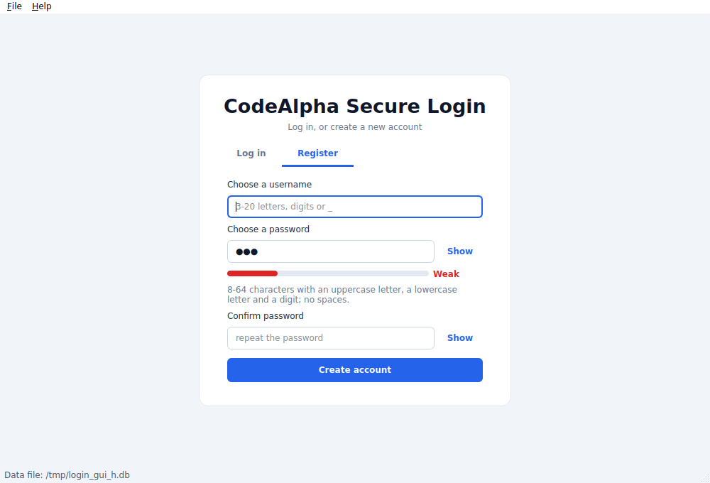
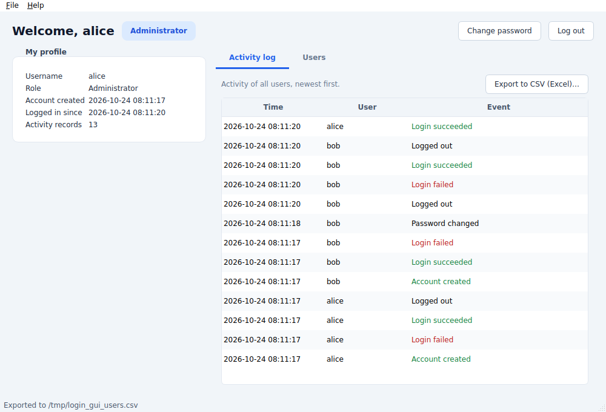
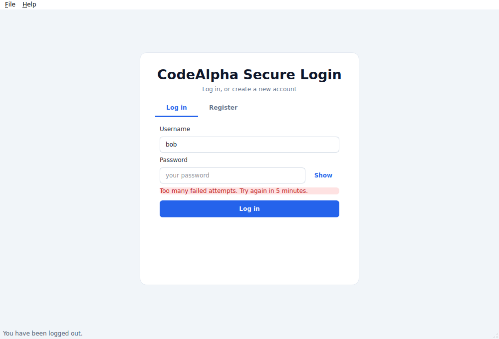

# Login & Registration System (Qt 6 GUI) — CodeAlpha C++ Internship

A desktop login and registration application built with **C++17** and **Qt 6 Widgets**.
Users register with a username and password, log in, see their profile and activity,
change their password, and export data to **CSV for Microsoft Excel**.

| Register (live strength meter) | Administrator dashboard | Locked account |
|---|---|---|
|  |  |  |

## Features

**Registration**
- Username: 3–20 letters, digits or `_`. Names are case-insensitive and **duplicates are rejected** (`Alice` = `alice`)
- Password: 8–64 characters with an uppercase letter, a lowercase letter and a digit, no spaces, not equal to the username
- Password + confirmation, **Show/Hide** button on every password box, and a **live strength meter** (Weak / Fair / Good / Strong)
- The first account created becomes the **administrator**

**Login and security**
- Passwords are **never stored**: only a random 16-byte salt and a 10,000-round salted SHA-256 hash, compared in constant time
- Wrong username and wrong password give the **same message**, so nobody can find out which usernames exist
- **Lockout:** 5 wrong passwords block the account for 5 minutes. The counter is saved to disk, so restarting the program does not reset it
- Clear success / error messages on every screen (green for success, red for errors)

**Dashboard**
- Profile panel (username, role, creation time, login time)
- **Activity log table** (account created, login succeeded/failed, account locked, password changed, logged out), newest first. Normal users see only their own activity, the administrator sees everyone's
- Administrator-only **Users table** (role, created, last login, Active/Locked status). Password data is never shown or exported
- **Change password** dialog with strength meter (the current password is required, and wrong guesses count towards the lockout)

**Storage and export**
- One local data file, `users.db` (plain text), saved atomically after every change (temp file + rename)
- Safe loading: header, field counts, username rules, salt/hash format, roles and numbers are all validated. A damaged or edited file stops the program with a clear message and is **never overwritten**
- **CSV export** of the activity log (everyone) and of the users list (administrator). UTF-8 BOM + Windows line endings so Excel opens it correctly. Text cells that start with `= + - @` are neutralised so they cannot run as Excel formulas

## Project layout

```
CMakeLists.txt
core/                  logic with no Qt code (unit-tested)
  UserStore.h/.cpp     registration, login, lockout, activity log, load/save
  Crypto.h/.cpp        SHA-256, salt, constant-time compare
  Csv.h/.cpp           Excel-friendly export
  FileUtil.h/.cpp      atomic file writing
gui/                   Qt 6 Widgets interface
  main.cpp             starts the app, loads the data file
  MainWindow.*         dashboard, menus, tables, export
  AuthPage.*           Login / Register tabs
  Dialogs.*            change-password dialog
  Widgets.*            PasswordEdit (Show/Hide) and StrengthMeter
  Style.h              style sheet
tests/test_core.cpp    unit tests for the core
```

## Build and run

You need **Qt 6.2 or newer** (Widgets), **CMake 3.16+** and a C++17 compiler.

### Qt Creator
1. Install Qt 6 with the [Qt Online Installer](https://www.qt.io/download-qt-installer) (a desktop kit + Qt Creator).
2. **File → Open File or Project…** → choose `CMakeLists.txt`.
3. Select your Qt 6 kit → **Configure Project** → **Run** (Ctrl+R).

### Visual Studio Code
1. Install the *C/C++* and *CMake Tools* extensions (suggested automatically by `.vscode/extensions.json`).
2. Set the environment variable `QT_ROOT_DIR` to your Qt kit folder (e.g. `C:\Qt\6.7.2\msvc2019_64`) or edit `.vscode/settings.json`.
3. Open the folder → **CMake: Configure** → pick a kit → **CMake: Build** → **CMake: Run Without Debugging**.

### Command line
```bash
# Ubuntu/Debian
sudo apt install qt6-base-dev cmake build-essential

cmake -S . -B build -DCMAKE_BUILD_TYPE=Release
cmake --build build
./build/LoginGUI                   # data file in your app-data folder
./build/LoginGUI ./users.db        # or choose the data file yourself
ctest --test-dir build --output-on-failure   # unit tests
```
macOS: `brew install qt cmake`, then add `-DCMAKE_PREFIX_PATH=$(brew --prefix qt)`.
Windows: add `-DCMAKE_PREFIX_PATH=C:/Qt/6.x.x/<kit>` and run `windeployqt LoginGUI.exe` before sharing the program.

## Using it
1. Open the **Register** tab, choose a username and a password (watch the meter), and press **Create account**. The first account is the administrator.
2. You are taken back to **Log in** with the username filled in. Enter the password.
3. On the dashboard use **Change password**, **Export to CSV (Excel)…**, or **Log out**. Shortcuts: `Ctrl+E` export activity, `Ctrl+Shift+E` export users, `Ctrl+L` log out.

## Honest security notes
- The lockout protects the **program**. Someone who steals `users.db` can still try passwords offline, so strong passwords matter. A production system would use Argon2/bcrypt/scrypt from a vetted library instead of repeated SHA-256.
- There is no "forgot password" feature: with no e-mail or other recovery channel, a locked-out or forgotten account can only be fixed by deleting its line in `users.db`.

## CodeAlpha submission checklist
- [ ] GitHub repo named `CodeAlpha_LoginSystem` (add `users.db` to `.gitignore`, already done)
- [ ] LinkedIn video: register (show weak/mismatched passwords being refused and a duplicate username), log in, wrong password, change password, export CSV and open it in Excel, trigger the lockout after 5 wrong attempts, show the administrator's Users tab
- [ ] Post the repo link on LinkedIn, tag @CodeAlpha, and submit the form
